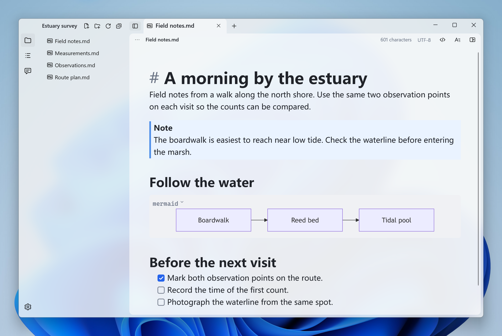
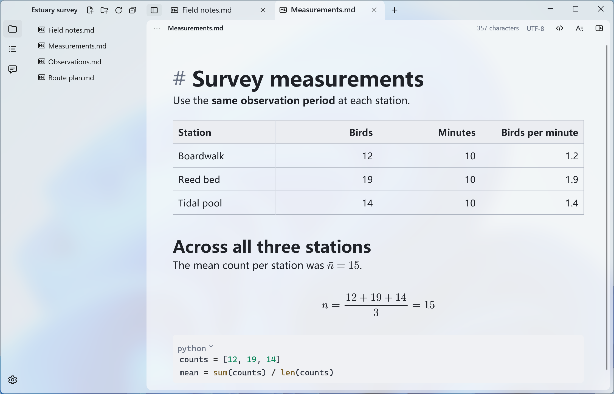
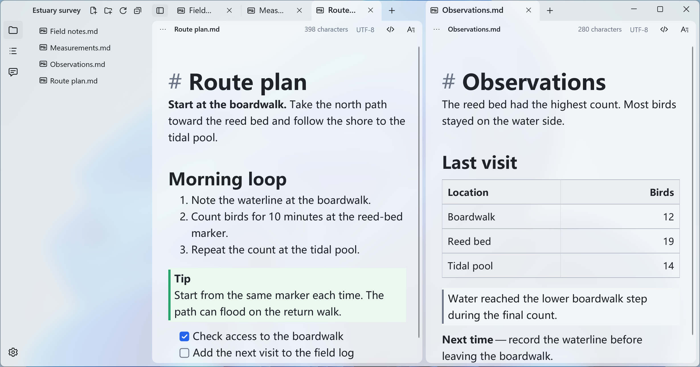
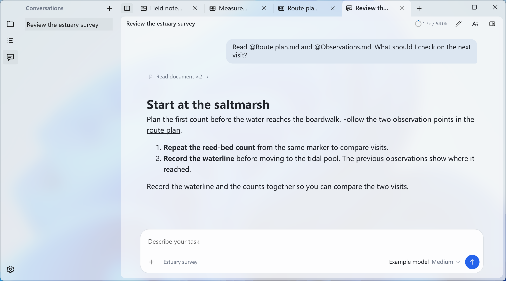
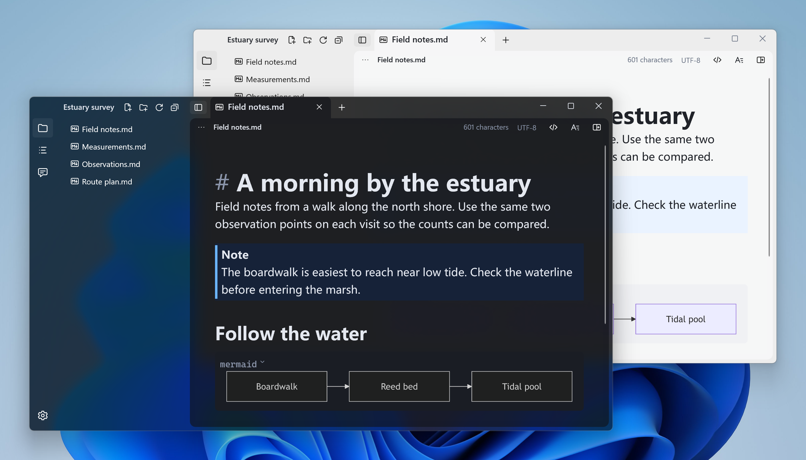
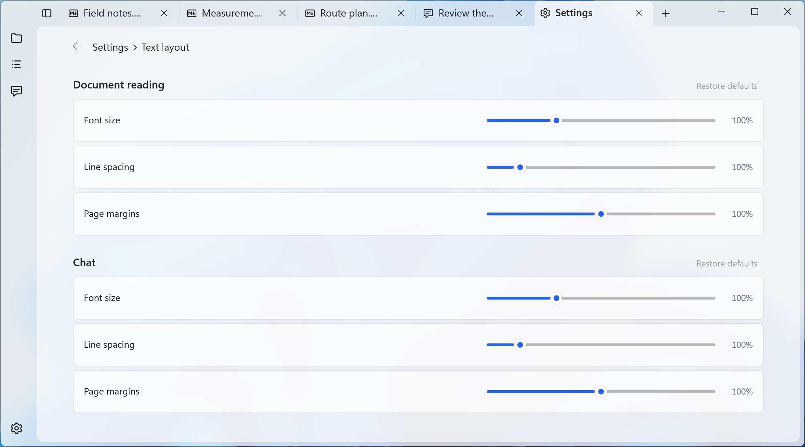

  

<h1 align="center">Folia</h1>

A native Markdown editor for Windows. Edit the rendered document or switch to its source. Files are saved locally as Markdown.

<a href="README.zh-CN.md">简体中文</a>

  
  
  
  
  

## Install

Find the Windows x64 installer and portable build under **Releases** on GitHub. Run the MSI to install Folia, or extract the portable ZIP and run `Folia.exe`.

## Markdown editing

Edit the formatted page directly, or switch to the source when you need to work with the Markdown itself. Both views edit the same file, and Folia preserves markers, whitespace, and escapes in text you leave untouched.

- The rendered view supports **LaTeX equations and Mermaid diagrams**, along with syntax highlighting, callouts, and footnotes.
- **Rich tables** support merged cells, colors, and row and column reordering. Folia reads and writes `gogoga-table` metadata.
- Reopen a file with a different encoding or export a document to **PDF**.

## Work side by side

Open a local folder as a workspace and keep a draft beside its reference material in the same window. Each pane has its own tabs and toolbar.

- The **sidebar** switches between the file tree and the current document’s outline. Files can open in preview tabs.
- Drag the **divider** to give either pane more room.
- **Tabs** can move between panes or windows. Markdown files and images dropped from Explorer open in the target pane.

## AI chat with your documents

Ask questions about your notes in a Folia conversation. Give the chat read-only access to open tabs or a folder you choose, and follow document citations in the reply back to the source line.

- Use `@` to **reference a document**. With a vision-capable model, you can paste images into the chat.
- **Markdown replies** render as they stream, and tool call records can be expanded.
- **Conversation history** is stored locally, with older messages loaded on demand.
- Connect an API under **Settings → AI providers**. Chat and inline completion share the configured models. Each conversation can use its own model and reasoning level.

Web search and page reading require provider and model support and permission in the conversation. [Agent chat guide](docs/agent-chat.md)

## Themes and typography

The window and the document can use different materials, such as an acrylic window with a solid page. Documents and chats remember their own text layout settings.

- Folia includes light, dark, and high-contrast **themes** and supports previewing and importing theme packages. Materials include Mica, acrylic, and solid color. [Themes and import format](docs/THEMES.md)
- Adjust **font size, line spacing, and page margins** from the toolbar. [Settings and shortcuts](docs/SETTINGS.md)

## Contributing and license

Build, test, and packaging instructions are in the [contributing guide](CONTRIBUTING.md).

Folia uses the MIT License. [License](LICENSE) · [Third-party notices](THIRD_PARTY_NOTICES.md)
