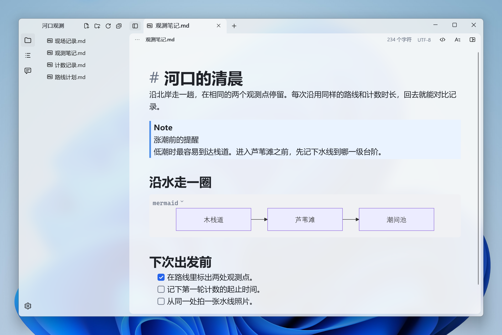
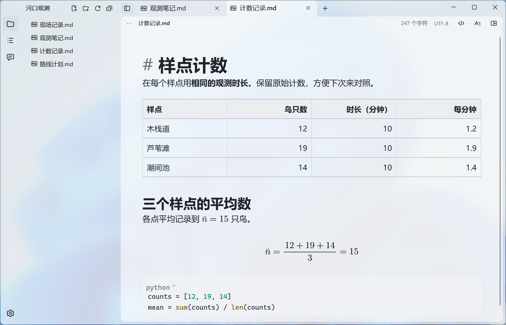
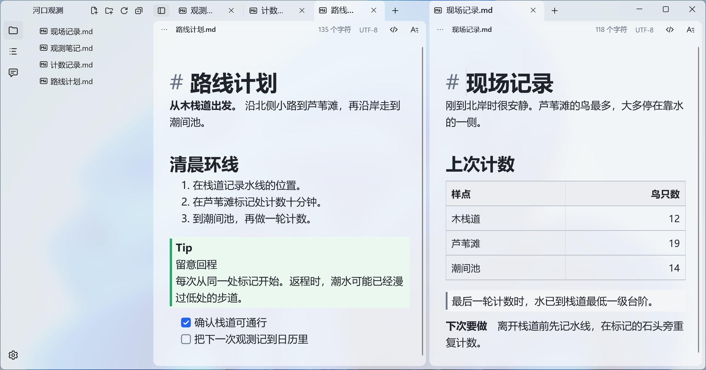
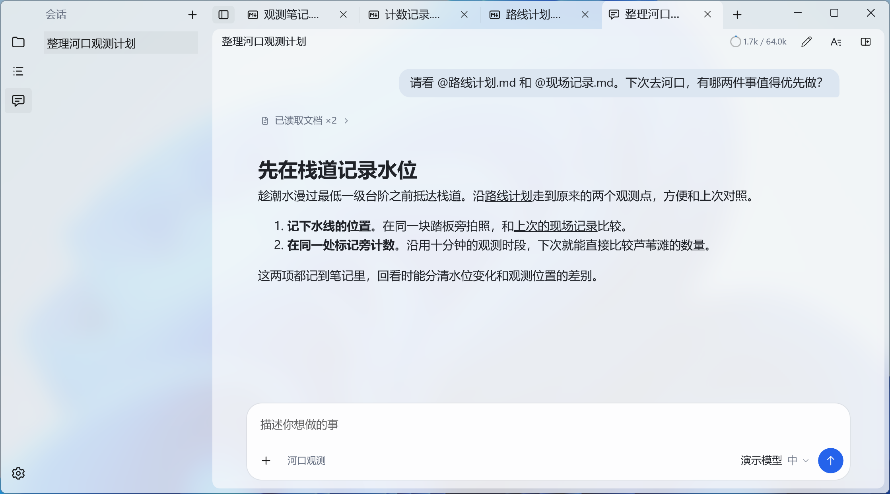
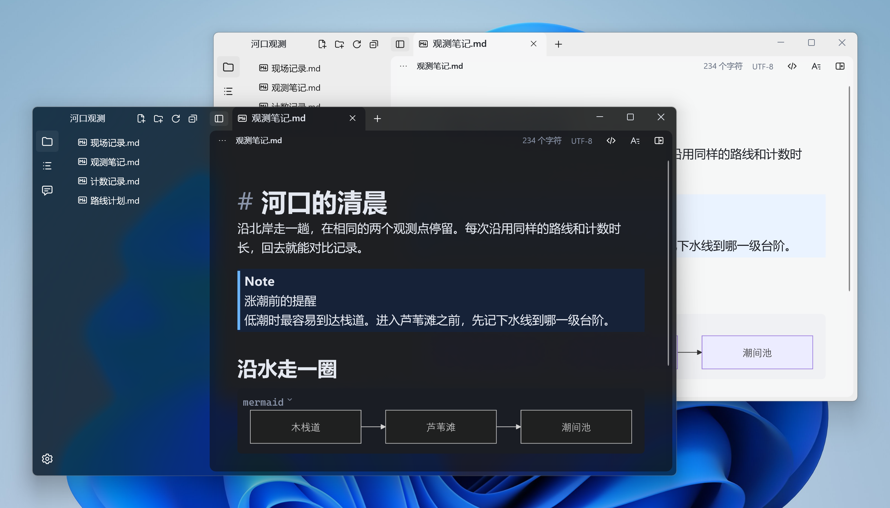
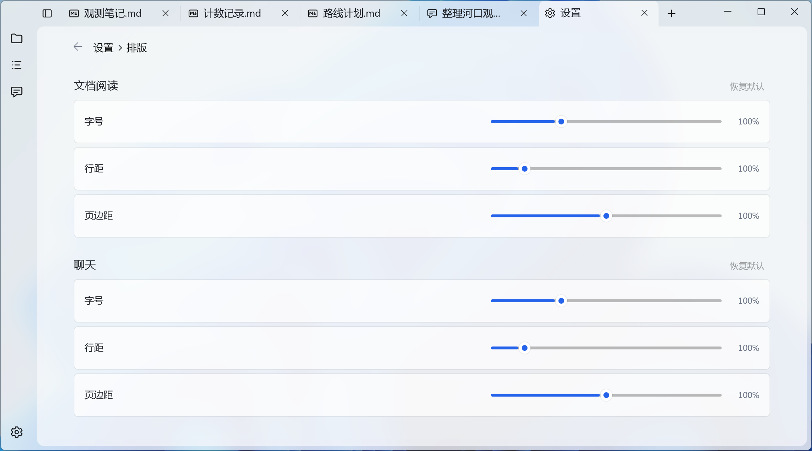

  

<h1 align="center">折笺 Folia</h1>

Windows 原生 Markdown 编辑器，支持所见即所得与源码编辑，直接读写本地 Markdown 文件。

<a href="README.md">English</a>

  
  
  
  
  

## 获取折笺

Windows x64 安装包与便携版均在仓库的 **Releases** 发布。运行 MSI 安装折笺，或解压便携版 ZIP 后运行 `Folia.exe`。

## Markdown 编辑

折笺支持直接编辑排版后的正文，也可以随时切换到源码。两种视图共用同一份 Markdown，保存时保留未修改部分的标记、空白和转义。

- 正文可渲染 **LaTeX 公式与 Mermaid 图表**，支持代码高亮、提示块和脚注。
- **富表格**支持合并单元格、设置颜色和拖动行列，兼容 `gogoga-table` 元数据。
- 文件可按指定编码重新打开，文档可导出为 **PDF**。

## 双栏工作区

折笺以本地文件夹为工作区。写作时可以把草稿和参考资料放在同一个窗口里对照，每一栏都有自己的页签和工具栏。

- **侧栏**可在文件树和文档大纲之间切换，文件可在预览页签中打开。
- 拖动**分隔线**可调整两栏的宽度。
- 支持**跨栏、跨窗口拖动页签**，也可以从资源管理器将 Markdown 文件或图片拖入指定分栏。

## AI 文档问答

折笺的 AI 会话可以围绕你授权的资料回答问题。会话可只读访问已打开的页签或指定目录，回复中的文档引用可直接跳到原文对应行。

- 输入 `@` **引用指定文档**。模型支持视觉时，可以直接粘贴图片。
- **Markdown 回复**流式渲染，工具调用记录可展开查看。
- **会话记录**保存在本机，较早的消息按需加载。
- 在 **设置 → AI 供应商** 中接入 API。聊天和行内补全共用模型配置，模型和推理力度可按会话选择。

联网搜索和网页读取需供应商与模型支持，并在会话中开启。 [聊天使用说明](docs/agent-chat.md)

## 主题与排版

窗口与正文可以使用不同的材质，例如亚克力窗口配纯色正文。文档与聊天也各自保存排版设置。

- 内置浅色、深色和高对比度**主题**，支持预览和导入主题包。材质可选云母、亚克力或纯色。 [主题配置与导入格式](docs/THEMES.md)
- **字号、行距和页边距**可在工具栏调整。 [设置和快捷键](docs/SETTINGS.md)

## 贡献与许可证

构建、测试与打包步骤见 [贡献指南](CONTRIBUTING.md)。

折笺采用 MIT 许可证。 [许可证](LICENSE) · [第三方许可清单](THIRD_PARTY_NOTICES.md)
