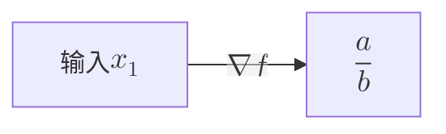
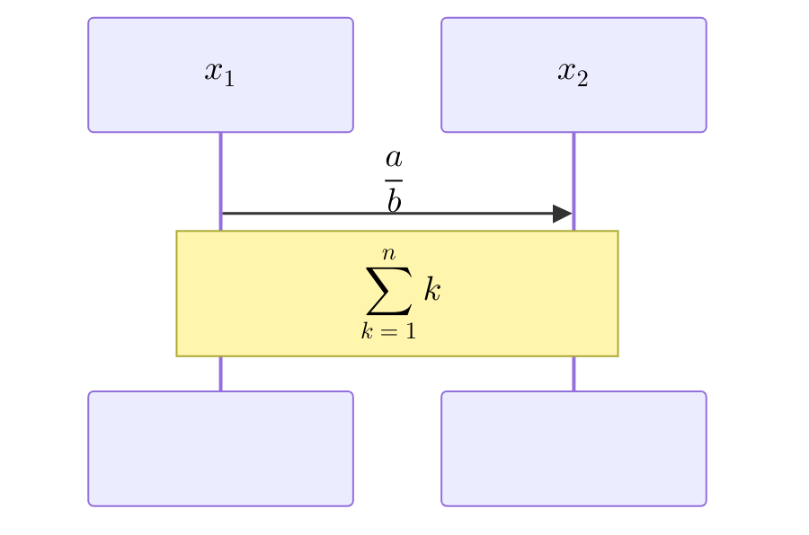
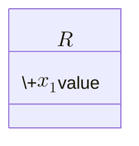

# Mermaid 中的数学

Mermaid 标签中的 `$$...$$` 使用 Folia 已有的 C++ MathJax 4.1.3 与 NewCM
字体渲染。应用不加载 JavaScript、MathJax 网页组件或额外字体副本。公式和普通文字
共同参与标签测量，最终输出纯 SVG，继续使用现有 usvg、Direct2D 和 PDF 渲染通路。

## 使用





公式可以与文字、多个公式、`<br/>`、HTML 粗体和斜体混排。检测发生在普通标签的
Markdown 和反斜杠转换之前，因此 `\nabla`、下标和星号不会被当成普通换行或强调。
使用一个 `$` 或未闭合的 `$$` 时，标签保留字面内容。

标签语法沿用锁定的 Mermaid 12.2.0：一个 `$$...$$` 配对不跨真实换行；包含数学的
标签走数学混排路径，其中普通的 `**文字**` 不再作为 Markdown 强调解释。
共享 createText 标签会折叠成对的反斜杠，Sequence 的数学路径则保留它们。
因此，矩阵行分隔符在共享标签中写作四个反斜杠 `\\\\`，在 Sequence 标签中写作
两个反斜杠 `\\`。这些行为与上游标签入口一致，不由 TeX 引擎猜测修复。

## 图族与配置

| 图族 | 使用数学的位置 | 配置边界 |
| --- | --- | --- |
| Flowchart | 节点、边、子图标题 | 使用有效的 `htmlLabels` |
| Sequence | 参与者、消息、注释、分组、控制块及分支标题 | 独立的数学标签路径 |
| Mindmap | 节点 | 使用全局 `htmlLabels` |
| Class | 类标题、注解、成员和方法；关系、注释及命名空间 | 类内行的数学触发与上游一致；其他标签使用 `htmlLabels` |
| State | 状态、复合状态、注释、边 | 使用有效的 `htmlLabels` |
| Agentflow | 节点、边、流程组 | 使用有效的 `htmlLabels` |
| Block | 节点、组合块、边 | 节点使用全局 `htmlLabels`；边使用有效的 `htmlLabels` |
| ER | 实体别名、属性单元格、关系 | 使用节点和边对应的 HTML 标签配置 |
| Requirement | 标题和属性字段 | 使用有效的 `htmlLabels`；普通图标题保持原规则 |
| Use Case | 用例、参与者、注释、结构化表格、边界及关系 | 使用有效的 `htmlLabels` |
| Swimlane | 节点、边、泳道标题 | 节点/边使用有效的 `htmlLabels`；泳道标题使用 `flowchart.htmlLabels` |

Swimlane 的标题在锁定上游中独立读取 `flowchart.htmlLabels`。需要数学标题时显式设置：

```yaml
config:
  flowchart:
    htmlLabels: true
```

Kanban、Architecture、C4 节点等上游强制使用普通 SVG 文字的位置，继续显示字面标签。
图的独立标题仍由原有标题绘制通路处理。这里列出的数学入口不表示任意 HTML/CSS
都可被原生标签解析器执行。

Class 的成员语法把行尾 `$` 用作 static classifier；直接让成员行以 `$$` 结尾会与
该语法冲突，官方解析器亦如此。可将公式放在类标题中，或让成员公式后面还有普通文字：



## 实现边界

`folia.mermaid.math_label` 只负责检测标签中的数学片段、组合测量结果及绘制。
普通文字通过平台回调获取 DirectWrite 的真实尺寸；公式通过
`folia.platform.mermaid_math` 调用现有 Math DLL 的新 C ABI。核心不依赖 Windows，
也不自己实现 TeX 或估算字宽。

新增的 `FoliaNativeMathRenderSvgFragment` 返回一个独立 SVG 根，
`FoliaNativeMathResultFragmentMetrics` 返回最终 CSS 像素宽、高和基线。
它们复用已有 TeX → MML → Common → Scene → SVG 管线。尺寸来自完成布局的 Scene，
包含实际字体缩放与百分比 frame，不能从舍入过的 `viewBox` 反算。
默认公式输出与旧 C ABI 保持原行为，现有公式缓存也保持原样。

一个图的数学渲染会话按需创建。Math DLL 拥有数学引擎与字体数据；Mermaid 不再静态
链接一份同样的数据。结果只持有 SVG 和尺寸，不保留 Scene。布局阶段需要复制的
测量结构共享不可变数学标签，避免同时复制整批字形路径。

SVG writer 在生成定义及引用时统一添加资源 ID 前缀，避免多个公式的 clip/glyph
资源互相覆盖。宿主不扫描、替换或修补已生成的 SVG。普通图与公式继承同一标签颜色；
TeX 中明确指定的颜色保留。纯 SVG 模式省去不可交互的隐藏 HTML tooltip，保留文字
tooltip；可见 `texhtml` 内容会明确报错，不静默丢弃。

公式作为一个不可拆分的数学片段参与布局。Sequence 的 `wrap: true` 仍可约束普通
文字，但长公式会扩大所需的演员、注释或控制框宽度，高公式也会扩大对应高度。
公式不会被按普通词语拆开、缩小，或仅改变绘制大小而继续沿用旧布局框。

## 验证与上游版本

Folia 的图布局基准仍是 Mermaid **12.2.0**，固定 commit 见
[source-lock.json](../../tools/mermaid-cpp/source-lock.json)。该版本的默认数学实现使用 KaTeX。
不同 Mermaid 版本可作为数学集成行为的参考，但若其图布局或默认数学字体不同，
不能将其整图坐标作为本项目版本的精确 oracle。

严格的公式对照使用官方 MathJax 与 Folia 相同的已提交 NewCM 配置。样例应覆盖
分式、积分、求和、矩阵、aligned、cases、化学式、颜色、删除线、空公式、错误公式
以及不同字号。比较应逐项检查宽、高和基线，并在仅规范化非绘制元数据的前提下比较
SVG 绘制树与栅格结果；不得删除有内容的字形或放宽像素阈值。

复现工具、锁文件、样例和判定规则位于
[math-oracle](../../tools/mermaid-cpp/math-oracle/README.md)。实际 C++ 集成测试调用生产
Math C ABI，并让数学尺寸进入各图族布局；混排测试由宿主提供真实字体测量。

验收应分别检查公式尺寸、生成的 SVG 片段以及实际渲染结果，并记录使用的
Math 运行库、字体环境、输入和源码版本。公式片段一致性不替代 Mermaid
整图浏览器对照、Windows DirectWrite 或 WinUI 验收。

## 构建与测试

集成构建启用 `FOLIA_BUILD_MERMAID=ON` 后，Mermaid 自动依赖现有 `FoliaNativeMath`。
独立 Mermaid 构建可通过 `FOLIA_NATIVE_MATH_RUNTIME` 指向该共享库；Windows 还需
`FOLIA_NATIVE_MATH_IMPORT_LIBRARY` 指向对应 `.lib`。不要传入没有新 fragment ABI 的
旧版数学库。具体命令见 [README](README.md#构建与测试)。

`FoliaMermaidMathTests` 测试真实 Math DLL 与 Mermaid 核心的集成。
纯公式 fixture 对普通文字测量请求报错，不用固定字宽冒充真实字体测量。
`FoliaMermaidTests` 中的独立标签契约测试使用明确的 provider 尺寸，验证几何组合、
配置开关和错误传播。两类测试的职责分别清楚。

`FoliaMathSvgBridgeTests` 是显式构建的轻量测试目标，复用完整数学套件中的 SVG writer
与 C ABI 测试。包括既有默认 SVG 输出的逐字节回归。
它没有加入默认 CTest 列表；构建该目标后直接运行即可。
