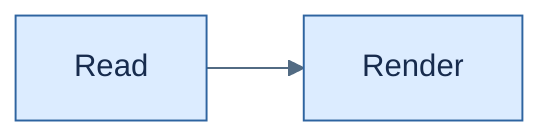

# Mermaid 主题与公共渲染 API

`folia::mermaid` 使用锁定的 Mermaid **12.2.0** 主题计算规则，提供 11 种
内置主题、变量自定义、源码局部覆盖和独立的请求配置。主题计算、选择和
渲染编排都属于平台无关 C++23 核心，可在 Linux 编译和测试。

新宿主推荐 `import folia.mermaid;`。它导出公共渲染入口、主题选项和原有
配置／测量类型；已有的 `folia.mermaid.*` 导入与 CMake 目标保持有效。
源码归属见 [模块组织](architecture.md)，构建见 [README](README.md)。

## 选择内置主题

| 配置名称 | C++ 枚举 `MermaidTheme` |
| --- | --- |
| `default` | `default_theme` |
| `dark` | `dark` |
| `base` | `base` |
| `forest` | `forest` |
| `neutral` | `neutral` |
| `neo` | `neo` |
| `neo-dark` | `neo_dark` |
| `redux` | `redux` |
| `redux-dark` | `redux_dark` |
| `redux-color` | `redux_color` |
| `redux-dark-color` | `redux_dark_color` |

名字区分大小写。`mermaid_themes()` 返回只读的主题清单，
`find_mermaid_theme(u"forest")` 返回可选枚举，`mermaid_theme_name(id)`
返回可选的标准名称。清单与主题构造共用同一登记表。

```cpp
import std;
import folia.mermaid;

using namespace folia::mermaid;

// measurer 是宿主提供的 TextMeasurer；必须提供真实字体解析与测量。
std::expected<DiagramSvg, std::string> example(const TextMeasurer& measurer) {
    ThemeOptions theme{.theme = MermaidTheme::forest};
    return render_diagram(u"flowchart LR\nA[Read] --> B[Write]", measurer, theme);
}
```

`DiagramSvg` 含 UTF-8 `svg`、`width` 和 `height`。
`render_diagram` 使用现有的准备、测量、布局和 SVG 管线，不引入另一套渲染器。
语法、配置、字体和数学服务的错误通过 `std::expected` 返回。

### 未指定与显式 default

```cpp
ThemeOptions automatic; // theme == std::nullopt
ThemeOptions classic_palette{.theme = MermaidTheme::default_theme};
```

未指定主题时，保留锁定版本中每个图族的默认主题。例如 Flowchart 使用
`redux-color`，Packet 使用 `default`。显式 `default_theme` 则设置根
`theme: default`，覆盖图族的默认主题。

**theme、look、layout 分别配置。** 选择 `forest` 不会顺便强制 `classic`
外观或改变布局算法。若需要经典外观，在源码中设置 `look: classic`，
或使用下面的完整 `ConfigSession` 接口。宿主还应自行选择透明 SVG 所在
画布的背景；不能假定每个图族都会绘制整个画布。

## 自定义主题变量

推荐以 `base` 为自定义调色板的起点。`ThemeOptions::variables` 对应
Mermaid 的 `themeVariables`，保存用户输入的原始变量。

```cpp
ThemeOptions custom{.theme = MermaidTheme::base};
custom.variables.mapping.emplace(u"primaryColor",
    ConfigValue{.kind = ConfigKind::string, .string = u"#dcecff"});
custom.variables.mapping.emplace(u"primaryTextColor",
    ConfigValue{.kind = ConfigKind::string, .string = u"#172b4d"});
custom.variables.mapping.emplace(u"primaryBorderColor",
    ConfigValue{.kind = ConfigKind::string, .string = u"#2e64a0"});
custom.variables.mapping.emplace(u"lineColor",
    ConfigValue{.kind = ConfigKind::string, .string = u"#526b83"});

auto result = render_diagram(source, measurer, custom);
```

颜色派生、嵌套图族变量和配置预算继续使用已有实现。不会把派生后的整套
颜色当作用户输入再次初始化，因此源码切换主题时，不会留下上一主题的
大量派生颜色。变量必须是 mapping；无效颜色、非法枚举、超出配置预算及
不允许的原型／方法键会返回错误，不修改传入的选项。

如需使用 JSON／YAML 构造完整配置，可使用已有的解析接口与 `ConfigSession`，
无需先将配置转为 `ThemeOptions`。

## 会话复用与优先级

```cpp
auto session = make_theme_session({.theme = MermaidTheme::forest});
if (!session) {
    // 处理 session.error()
    return;
}
auto first = render_diagram(source_a, measurer, *session);
auto second = render_diagram(source_b, measurer, *session);
```

`make_theme_session` 调用已有 `ConfigSession::initialize()`，每次返回独立、
拥有自身配置的会话。渲染请求使用会话副本；一张图的 frontmatter、init 指令
及解析失败不会改变下一张图的配置。

配置沿用原有优先级：

1. 当前图源码中的配置。
2. 宿主 `initialize()`／`make_theme_session()` 的配置。
3. 锁定版本的图族默认值及全局默认值。

在同一来源层内，图族配置高于该层根配置。



旧式 `%%{init: {"theme": "forest"}}%%` 也继续有效。选择图族主题时可写：

```yaml
config:
  theme: neutral
  flowchart:
    theme: dark
```

完整配置、布局选择或自定义会话预算使用现有接口：

```cpp
auto session = ConfigSession::create();
if (!session) return; // 在调用方处理 session.error()
ConfigValue config{.kind = ConfigKind::mapping};
config.mapping.emplace(u"theme",
    ConfigValue{.kind = ConfigKind::string, .string = u"forest"});
config.mapping.emplace(u"look",
    ConfigValue{.kind = ConfigKind::string, .string = u"classic"});
auto configured = session->initialize(config);
if (!configured) return; // 在调用方处理 configured.error()
auto result = render_diagram(source, measurer, *session);
```

## 字体、数学和可用宽度

`render_diagram` 有两个重载：第三个参数分别为 `ThemeOptions` 和
`const ConfigSession&`；其余参数相同。

```cpp
auto result = render_diagram(
    source, measurer, theme, render_math, FrontendLimits{}, available_width);
```

`render_math` 是现有 `MathLabelRender` 回调，`available_width` 是宿主可选提供的
可用宽度。它们直接传给现有测量与渲染编排；没有替代字体度量、缓存副本或
独立数学实现。需要分阶段处理的宿主仍可调用 `prepare_native_diagram()` 与
`render_measured_diagram()`。

## Windows 与 C ABI

Windows 的 `render_mermaid_utf8` 可接收 `ThemeOptions` 或已有 `ConfigSession`；
UTF-8 解码与 DirectWrite 位于平台层，主题和渲染逻辑仍在核心。

DLL 新增 `FoliaNativeMermaidRenderWithTheme`，在 source 和 length 后接收
UTF-8 主题名称指针及长度。名称最长 32 字节，未知名称返回输入错误。
输出分配、`FoliaNativeMermaidFree` 和状态码沿用既有接口。
源码中的主题配置可覆盖命名主题；该入口保留图族默认 look。
宿主可从索引 0 开始调用 `FoliaNativeMermaidThemeName` 枚举主题，直到返回空指针。
返回值是 DLL 持有的以零结尾的 UTF-16 名称。折笺设置页用同一清单提供独立的
Mermaid 主题选择，也可选择跟随折笺的浅色／深色主题。

既有 `FoliaNativeMermaidRender(..., bool dark, ...)` 的 ABI 与语义保留：
`false` 是 `default`，`true` 是 `dark`，并继续显式使用 `classic` 外观。
因此旧应用不会因为本次 API 增补而自动切换默认外观。

## 图族默认样式与画布

不同官方主题并不都定义每个图族的全部变量。Radar 与 XY 按锁定版官方
渲染器的规则，把对应的默认主题变量与当前主题合并，再使用图族样式。
明确提供的颜色、嵌套变量和数值（包括零）保留优先权。

也有图族使用自己的样式缺省值。例如官方的 `neo-dark`、`redux-dark` 和
`redux-dark-color` 没有定义 Packet 专属变量，Packet 因而沿用黑色位标／标题
和浅灰字段背景。它们放在深色宿主画布上时，不能假定已有完整的暗色对比度。
`neo-dark` 的 State 交替复合背景也沿用上游的浅色值。本实现保留这些锁定
预设的语义；需要调整的宿主可以选用 `dark`，或通过 `base` 与对应图族变量
定义适合自己画布的调色板。

## 验证范围

核心测试覆盖全部 11 个主题的名称往返、已有初始化语义和实际 SVG 等价，
自定义变量、图族配置、源码覆盖、失败隔离，以及公共入口向字体和数学服务
传递参数与错误。原有上游主题变量 fixture 继续参与完整核心测试。
Windows C ABI 测试另覆盖命名主题、原接口外观一致性及无效参数。

跨平台完整图验证使用 `FoliaMermaidRegressionProbe` 与真实 Pango 测量，
走同一个 `render_diagram` 入口。原生图渲染和栅格检查不等于与官方整图 SVG
完全一致。主题矩阵从已有语料中为每个图族选择一例，逐一应用全部内置主题，
用于发现主题配置和绘制路径问题；它不替代全语料的官方 SVG 对照。可只生成 SVG：

```sh
python3 tools/mermaid-cpp/regression/render-themes.py \
  --probe build/mermaid-cpp/FoliaMermaidRegressionProbe \
  --output build/mermaid-themes --no-raster
```

Linux 需能使用 PyGObject/Pango 和 fontconfig 的 Python（某些环境为
`/usr/bin/python3`）；Windows 使用 probe 内的 DirectWrite。
去掉 `--no-raster` 可用 librsvg、Cairo 和 Pillow 栅格化原始 SVG 并生成
代表图族的主题对照图。`--family radar --family xy` 可定向复验。
报告保留每例输入、主题、SVG／位图散列、失败及工具版本；只要有失败就
返回非零，不会把原生生成通过标成官方 SVG 对照通过。
